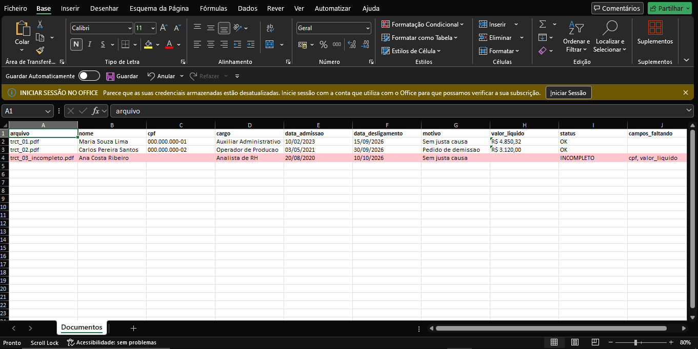
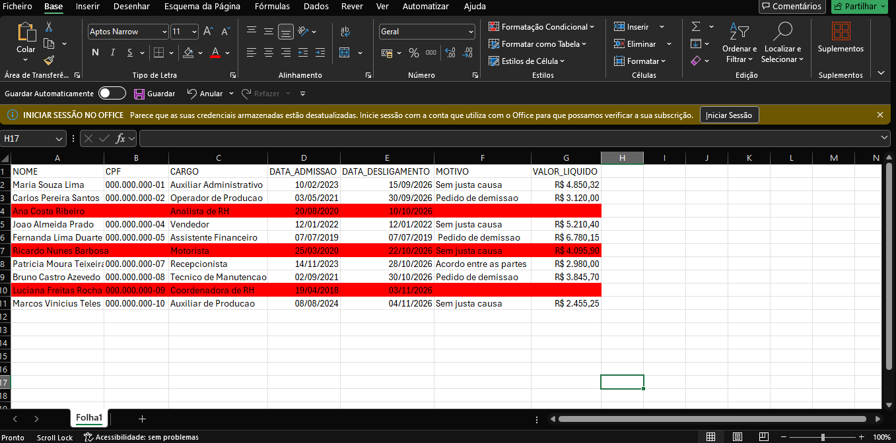

# SmartDocs AI



Automação que lê documentos de RH em PDF, extrai os dados com IA (Gemini), organiza tudo em uma planilha Excel e marca os documentos incompletos.

## Problema
Conferir documentos de rescisão manualmente é lento e sujeito a erro: é preciso abrir cada PDF, copiar os campos para uma planilha e descobrir o que está faltando.

## Solução
O programa faz esse trabalho sozinho:
1. Lê cada PDF da pasta `documentos` (pdfplumber).
2. Envia o texto ao Gemini, que devolve os campos em JSON. Campo ausente vira `null`, sem inventar dados.
3. Gera o `resultado.xlsx`. Documentos com campos faltando ficam em vermelho, com a lista do que falta.

## Resultado

### Comparação: conferência manual
Planilha preenchida à mão em cerca de 13 minutos, com os documentos incompletos marcados em vermelho:



- - Testado com 10 documentos fictícios, sendo 3 incompletos, todos identificados corretamente. (2 completos e 1 incompleto). O incompleto foi identificado corretamente, apontando `cpf` e `valor_liquido`.
- - Teste com 10 documentos fictícios (3 incompletos): conferência manual em cerca de 13 minutos vs 10 a 30 segundos com o SmartDocs AI (mais de 25 vezes mais rápido; o tempo varia conforme a resposta da API). Os 3 incompletos foram identificados corretamente.: [PREENCHER] manualmente vs [PREENCHER] com o SmartDocs AI.

## Tecnologias
Python, pdfplumber, openpyxl, Google Gemini API.

## Como rodar
```powershell
python -m venv venv
.\venv\Scripts\Activate.ps1
pip install -r requirements.txt
```
Crie um arquivo `.env` com sua chave:
```
GEMINI_API_KEY=sua_chave_aqui
```
Execute:
```powershell
python src/main.py
```

## Aviso
Todos os documentos do projeto são fictícios. Não use dados reais de pessoas.

## Próximos passos
- Interface para enviar os PDFs
- Suporte a outros tipos de documento